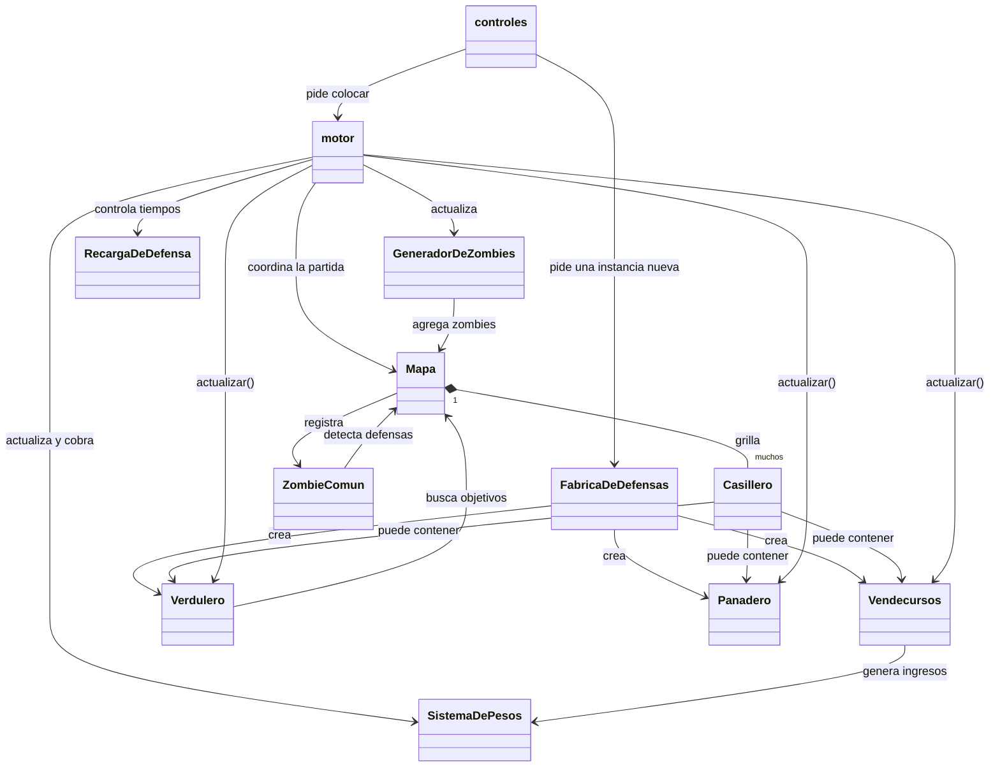

# Conurbano vs. Zombies: checkpoint 1

## Estructura y responsabilidades

| Archivo | Responsabilidad |
| --- | --- |
| `mapa.wlk` | Grilla 5 × 9, ocupación, colección de defensas activas y zombies por fila. |
| `defensas.wlk` | Vendecursos, Verdulero y Panadero con vida, costo y comportamiento propio. |
| `zombies.wlk` | Movimiento por fila, detección de defensas, mordiscos, daño y llegada a la casa. |
| `pesos.wlk` | Saldo, generación automática, cobros e indicador visual. |
| `motor.wlk` | Ticks, recargas por tipo, apariciones, retiro de muertos y fin de partida. |
| `controles.wlk` | Selección 1/2/3, cursor, Enter e indicador de selección y recarga. |
| `fabricaDeDefensas.wlk` | Construcción de defensas y valores de balance. |
| `inicio.wlk` | Crea el primer zombie de la demo. |
| `juego.wpgm` | Configura la partida, los indicadores y el temporizador de 100 ms. |

## Polimorfismo sin herencia

El motor recorre `mapa.defensas()` y envía el mismo mensaje `actualizar()` a
cada objeto. No pregunta su clase ni elige su comportamiento con condicionales:

- Vendecursos genera 25 pesos cada 10 ticks, salvo que esté bloqueado o muerto.
- Verdulero busca al zombie vivo más cercano delante suyo en la misma fila y
  le hace 20 de daño cada 10 ticks. No necesita proyectiles para aplicar daño.
- Panadero es una barrera pasiva de 300 de vida; recibe mordiscos sin atacar.
  Su `actualizar()` sólo avanza la animación del golpe; no tiene intervalo de acción.
- Las tres defensas usan `AnimacionDeDefensa`: cada ataque, venta o golpe inicia
  una secuencia que avanza un cuadro por tick (100 ms) y vuelve a la imagen quieta.
  La animación no depende de que ocurra otra acción; un nuevo evento la reinicia.

Las tres clases también responden a `recibirDanio()`, `estaMuerta()`, `costo()`,
`tipo()`, `intervaloDeColocacion()`, `position()` e `image()`. El motor utiliza
el identificador `tipo()` únicamente para compartir la recarga de colocación
entre todas las instancias de una misma defensa.

## Ciclo de un tick

1. Retirar muertos y comprobar si un zombie ya llegó a la casa.
2. Si sigue la partida, actualizar recargas y generación automática de pesos.
3. `actualizarDefensas()` envía el mismo mensaje a todas las defensas.
4. Retirar muertos: un zombie abatido no puede morder en ese tick.
5. `actualizarZombies()` actualiza enemigos; luego se retiran defensas destruidas.
6. Comprobar derrota y, si sigue la partida, procesar nuevas apariciones.

Cada 50 ticks el sistema agrega 25 pesos. El generador crea un zombie cada
30 ticks en la última columna y una fila aleatoria válida. El zombie inicial
se agrega aparte para que la demo comience con un enemigo visible.

## Movimiento y combate

El mapa jugable tiene 5 filas y 9 columnas (45 casilleros). La sexta fila
visual está reservada para los indicadores. Las celdas visuales son de 100
píxeles, acordes a los sprites existentes.

Las coordenadas lógicas son fila/columna; las visuales son `game.at(columna,
fila)`. El zombie usa `casillasPorPaso` para la distancia y `ticksEntrePasos` para
el intervalo. Avanza hacia la izquierda una casilla entera cada 30 ticks
(3 segundos). Conserva la velocidad media anterior de 0.2 casillas cada
6 ticks, usando posiciones enteras que el renderer puede dibujar sin
redondeos de movimiento. Antes de
moverse, revisa todo el tramo del paso y se detiene exactamente en la primera
defensa viva que encuentra en su fila. Esto evita atravesar una casilla por
usar posiciones decimales, incluso si un paso cruza varias casillas.

Al detenerse en una defensa, hace 10 de daño cada 2 ticks y no avanza hasta que
sea destruida. Los muertos se retiran del mapa y de la pantalla; al destruir
una defensa, su casillero queda libre. La casa está en la columna 1: alcanzar
o cruzar ese límite detiene la partida, sus ingresos y nuevas colocaciones.

## Colocación y pantalla

Las teclas 1/2/3 seleccionan Vendecursos/Verdulero/Panadero; las flechas mueven
el cursor y Enter coloca una instancia nueva. Se valida partida activa,
casillero libre, límites, saldo y recarga mediante `motor.puedeColocarDefensa()`.
La fábrica concentra vida, costo e intervalos de cada defensa; los controles
solo solicitan la instancia del tipo seleccionado. Un rechazo no cobra, no ocupa ni
inicia una recarga. La selección se conserva.

Los costos son 25/10/5 pesos. Las recargas por tipo son 5/5/30 ticks; empiezan
solo tras una colocación válida y continúan aunque la defensa sea destruida.
La franja superior muestra pesos, estado de partida y selección/recarga.

## Verificación y alcance

Ejecutar `wollok test -p ./` y `wollok lint -p ./`. Los tests cubren ocupación,
controles por teclado, economía, ventas, objetivos del Verdulero, movimiento,
combate, recargas, retiro de muertos, derrota y apariciones. La integración
del motor comprueba efectos distintos al actualizar las tres defensas.

La verificación local del 6 de octubre de 2026 pasó los 91 tests; el lint no
informó errores ni advertencias. También se comprobó en el navegador la
colocación por teclado de las tres defensas, los ingresos, las apariciones y
los indicadores. El fin de partida y el combate se verifican con tests de
integración. Los indicadores están en la fila superior y el tamaño de celda evita que
los sprites de las filas jugables los tapen. No se retiran y agregan de nuevo
en cada tick.

El checkpoint no implementa Carnicero, Aguatero, fusiones, Migas ni zombies
especiales. El bloqueo del Vendecursos está disponible para una futura
integración con el inspector. Los efectos temporales se incorporarán cuando
se implementen las fusiones. No hay condición de victoria: se juega hasta la derrota.

## Colección activa y consultas del mapa

El mapa conserva una colección privada de defensas activas, compartida con
los casilleros de su grilla. Colocar o quitar desde el mapa o directamente
desde un casillero actualiza esa misma colección. `defensas()` devuelve una
copia para impedir modificaciones externas y permitir retiros seguros al
recorrerla. Una instancia no puede ocupar dos casilleros simultáneamente.
Recrear la grilla reemplaza la colección: un casillero antiguo no altera el
estado del mapa nuevo.

`casilleroEn(fila, columna)` accede directamente al índice
`fila * columnas + columna`, después de validar límites y coordenadas
enteras. Consultar una defensa o listar las defensas activas no requiere
recorrer todos los casilleros.
