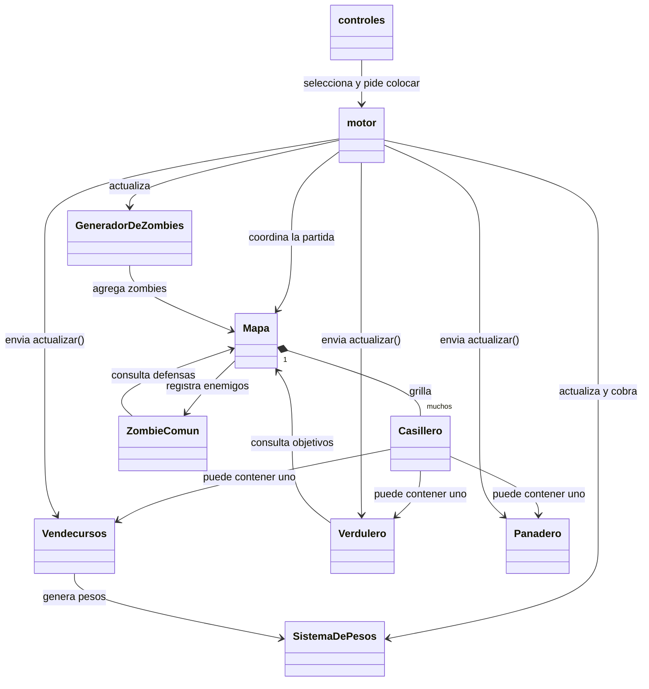

# Explicaciones teóricas

*Completar comentando dónde se aplicaron los distintos conceptos buscados*

# Diagramas

*Incluír al menos un diagrama para comunicar su solución*

## Estructura inicial de Conurbano vs. Zombies

Los archivos de dominio contienen declaraciones y cuerpos vacíos con `TODO`,
no un juego implementado. Los métodos con `TODO` no hacen nada y no devuelven
aún los resultados indicados en los comentarios. Los métodos visuales
`position()` e `image()` ya están implementados. Los métodos `iniciar()` de
`motor` y `controles` ya asignan sus dependencias para conectar el punto de entrada.
Cada clase es independiente y declara sus propios atributos y métodos.
Todas las defensas tienen un placeholder `actualizar()`: el motor podrá enviar
ese mensaje a cualquiera de ellas. Este polimorfismo no necesita herencia,
una clase base ni métodos abstractos.

`juego.wpgm` conserva el fondo y personaje de ejemplo, crea el mapa, el sistema
de pesos y el generador, e inicia el motor y los controles. Un temporizador
llama a `motor.actualizar()` cada 100 ms. Este método sigue vacío: la conexión
no implementa todavía los ticks de dominio ni dibuja el mapa nuevo.

La configuración provisional del programa usa 9 filas (reserva la fila
superior para el fondo), 20 columnas, 100 pesos iniciales, generación de
25 pesos cada 50 ticks y aparición de zombies cada 30 ticks. Ajustar esos
valores con el equipo. Los intervalos solo tendrán efecto al implementar
los métodos pendientes. El registro de teclas y clicks también sigue pendiente.

| Archivo | Responsabilidad y declaraciones |
| --- | --- |
| `mapa.wlk` | `Mapa` y `Casillero`: grilla, ocupación, defensas y zombies. |
| `defensas.wlk` | Vendecursos, Verdulero y Panadero como clases independientes con sus métodos visuales. |
| `zombies.wlk` | `ZombieComun`, con sus métodos visuales. |
| `pesos.wlk` | `SistemaDePesos`: saldo, generación automática y gastos. |
| `motor.wlk` | Objeto `motor` y `GeneradorDeZombies`: partida, ticks, apariciones, recargas y eliminación de muertos. |
| `controles.wlk` | Objeto `controles`: selección con 1/2/3 y pedido de colocación. |

Las flechas señalan dependencias previstas y la composición representa la
grilla. Cada casillero contiene como máximo una defensa en total, de cualquiera
de esas clases. No hay relaciones de herencia. Los cuerpos que concretan las
dependencias siguen pendientes.

### Contratos para completar el checkpoint 1

- Usar `fila` y `columna` como coordenadas lógicas. Los métodos `position()`
  usan `game.at(columna, fila)`. Falta acordar el sentido de avance y el
  límite que representa la casa.
- Al construir objetos, suministrar los atributos sin valor inicial. Definir
  dimensiones, vida, costos, daño, velocidad, saldo inicial e intervalos con el
  equipo; no hay valores de balance inventados en el esqueleto.
- `Mapa` almacena defensas a través de sus casilleros; `defensas()` deberá
  devolverlas. `zombies` es la colección de enemigos presentes.
- `motor.colocarDefensa(...)` coordina la validación de límites, ocupación,
  saldo y recarga. Si se rechaza la colocación, no debe ocupar ni cobrar.
  `Casillero` también debe impedir que se reemplace una defensa existente.
- Separar la recarga para volver a colocar un tipo (`intervaloDeColocacion`)
  del tiempo entre acciones de una instancia (`intervaloDeAccion`).
- El motor enviará `actualizar()` a todas las defensas sin preguntar su tipo.
  Vendecursos genera pesos periódicamente, Verdulero ataca su línea y Panadero
  funciona como barrera de alta vida. El comportamiento concreto queda pendiente.
- `defensaEn(...)` y `defensaAlcanzada()` deberán devolver una defensa o `null`;
  las consultas `estaMuerto()`, `estaMuerta()`, `alcanzaPara(...)`,
  `contiene(...)` y `puedeColocarDefensaEn(...)` deberán devolver booleanos.
- Usar un tick como la unidad de actualización de los intervalos declarados.
  Su temporizador ya está registrado en `juego.wpgm`. El motor deberá
  retirar muertos, procesar apariciones y comprobar la llegada a la casa.
- `controles` creará una instancia nueva por colocación. Selección propuesta
  por los requisitos: 1 Vendecursos, 2 Verdulero, 3 Panadero.

### Parte visual en las mismas clases

Vendecursos, Verdulero, Panadero, ZombieComun y Casillero responden a
`position()` e `image()`. Una instancia se puede registrar con
`game.addVisual(unaInstancia)` y retirar con `game.removeVisual(unaInstancia)`.
El motor deberá coordinar ese registro con la colocación y eliminación en el
mapa, usando la misma instancia para el dominio y la pantalla.

Cambiar `fila` o `columna` modifica la posición que devuelve `position()`;
no se almacena una segunda posición visual. Cada clase declara estos métodos
directamente, sin herencia.

ZombieComun utiliza `zombie1.png`; su propiedad `imagen` puede cambiar a
`zombie2.png` para una futura animación. Las defensas usan `alien_azul.png`
como placeholder y permiten indicar `imagen` al construirlas. Casillero usa
`tile_centro.png`; el fondo existente ya dibuja el terreno, por lo que no es
necesario agregar también cada casillero a la pantalla.

El objeto `zombie` de `personajes.wlk` sigue siendo el ejemplo visual actual.
Reemplazarlo por una instancia de ZombieComun al implementar la creación de
enemigos. Agregar los métodos visuales a las clases no implementa movimiento,
combate, animación ni generación de enemigos.

### Tests pendientes para Lucho

El único test ejecutable sigue siendo el ejemplo original. No hay tests de
comportamiento nuevo porque los placeholders aún no lo implementan.

- Mapa/casillero: colocar una defensa y rechazar una segunda en la misma casilla.
- Pesos/motor: generación por intervalo, cobro de una colocación válida y
  conservación del saldo ante falta de fondos, casilla ocupada o recarga pendiente.
- Defensas: envío del mismo mensaje `actualizar()` a Vendecursos, Verdulero y
  Panadero, comprobando generación de pesos, ataque en línea y resistencia.
- Zombie común: avance en una fila, ataque al alcanzar una defensa, recepción
  de daño y eliminación al llegar a cero de vida.
- Integración: ticks que coordinan los objetos, aparición periódica y
  selección de defensas con 1/2/3.

Validar la estructura con `wollok lint -p ./` y ejecutar los tests con
`wollok test -p ./`. Los atributos privados sin usar generan advertencias
esperables hasta que se completen los cuerpos.
