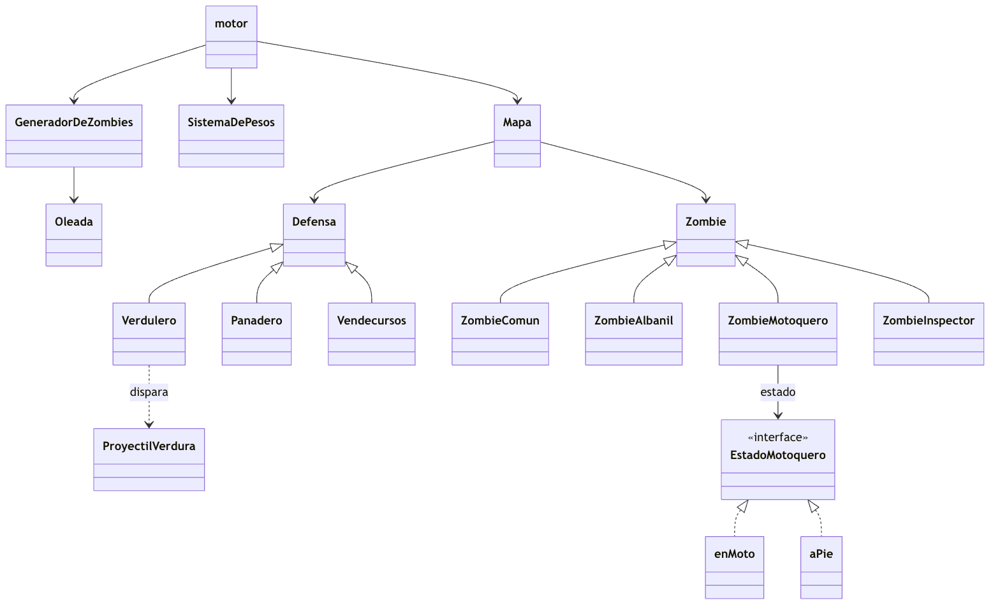
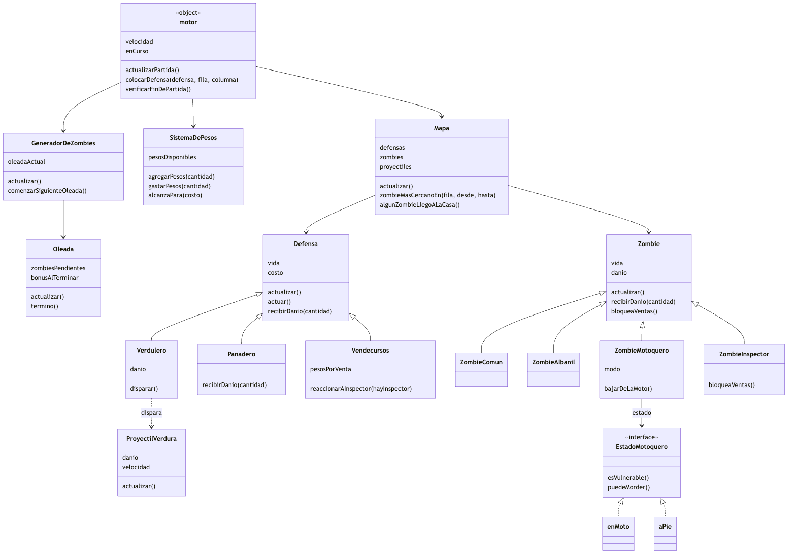

# Explicación técnica del dominio

El diseño separa la coordinación del juego (`motor`, `GeneradorDeZombies`), el tablero y ciclo de entidades (`Mapa`), los actores del dominio (`Defensa`, `Zombie`, `ProyectilVerdura`, `SistemaDePesos`) y la capa de entrada/HUD (`controles` e indicadores).

---

## Diagrama de clases

### Versión simple

### Versión con atributos y métodos

---

## Motor y configuración (`juego.wpgm`, `motor.wlk`)

* **`ConurbanoVsZombies` (`juego.wpgm`)**: configura el tablero de `9×6` (5 filas jugables y 1 fila superior para el HUD), instancia `Mapa`, `SistemaDePesos` y `GeneradorDeZombies`, inicializa `motor` y `controles`, y registra el `game.onTick` principal a 60 Hz.
* **`motor`**: orquesta la partida. En cada tick ejecuta `actualizarPartida()` 1 o 2 veces según `velocidad` (`1x`/`2x`), enviando `actualizar()` polimórficamente a `recargas`, `sistemaDePesos`, `mapa` y `generadorDeZombies`. Además valida y efectúa la colocación de defensas (partida activa, casillero libre, saldo y recarga) y verifica derrota o victoria.
* **`RecargaDeDefensa`**: lleva la cuenta regresiva de ticks por tipo de defensa para impedir colocaciones consecutivas antes de tiempo.

---

## Tablero y ciclo de entidades (`mapa.wlk`)

* **`Mapa`**: administra la grilla de `Casillero` y las colecciones activas de `defensas`, `zombies` y `proyectiles` junto con su ciclo visual en `wollok.game`. En cada `actualizar()`:
  1. Consulta si hay algún zombie que bloquee ventas y notifica a las defensas (`reaccionarAInspector`).
  2. Envía `actualizar()` polimórficamente a todas las entidades activas.
  3. Retira las entidades muertas delegando en `entidad.retirarseDe(self)`, sin preguntar por su clase.
  También resuelve validaciones de colocación (`puedeColocarDefensaEn`) y consultas espaciales (`zombieMasCercanoEn`, `defensaEn`, `algunZombieLlegoALaCasa`).
* **`Casillero`**: mantiene la referencia a la defensa que lo ocupa y determina la imagen de fondo (casa en la columna 0 o calle).

---

## Defensas y selección (`defensas.wlk`)

* **`Defensa`**: clase base con manejo de vida (`recibirDanio`, `estaMuerto`), retiro del mapa (`retirarseDe`) y un ciclo común `actualizar()` que avanza la animación y delega la lógica específica en `actuar()`.
* **`Verdulero`**: busca al zombie vivo más cercano delante suyo en su fila (`mapa.zombieMasCercanoEn`) y, al cumplirse su cadencia, inicia su animación de ataque para instanciar un `ProyectilVerdura`.
* **`Panadero`**: barrera defensiva pasiva; sobrescribe `recibirDanio()` para reducir un 30% el daño recibido y disparar su animación de cobertura.
* **`Vendecursos`**: suma pesos periódicamente en `SistemaDePesos`, salvo cuando está bloqueado por un inspector (`reaccionarAInspector`).
* **`TipoDeDefensa` y `ningunaDefensa` (*Null Object*)**: los objetos `tipoVendecursos`, `tipoVerdulero` y `tipoPanadero` encapsulan la creación con sus valores de balance, la colocación en `motor` y sus sprites. `ningunaDefensa` representa la ausencia de selección sin usar condicionales ni `null`.
* **`Animacion`**: secuencia de cuadros por ticks que ejecuta un bloque callback al alcanzar el último cuadro (disparo o venta).

---

## Proyectiles (`proyectiles.wlk`)

* **`ProyectilVerdura`**: avanza hacia la derecha en pasos continuos (`velocidad`). Detecta impactos consultando `mapa.zombieMasCercanoEn` sobre el tramo `[xAnterior, position.x()]` recorrido en el tick, evitando saltear zombies con velocidades decimales y sin depender de colisiones gráficas de `wollok.game`. Al impactar aplica daño y se marca muerto; también muere si sale del tablero.

---

## Zombies y estados (`zombies.wlk`)

* **`Zombie`**: clase base que actualiza la animación de daño, verifica si llegó a la casa (`x <= 0`), muerde periódicamente a la defensa inmediata a su izquierda (`defensaAlcanzada()`) o avanza una casilla hacia la izquierda cada `ticksEntrePasos`.
* **`ZombieComun` y `ZombieAlbanil`**: variantes diferenciadas por vida y velocidad de avance.
* **`ZombieMotoquero`**: aplica el patrón *State* delegando comportamiento en los objetos `enMoto` y `aPie`. En `enMoto` avanza mucho más rápido y es inmune al daño; al intentar atacar una defensa cambia a `aPie`, pasando a recibir daño y morder normalmente.
* **`ZombieInspector`**: sobrescribe `bloqueaVentas()` para inhabilitar la producción de todos los `Vendecursos` mientras permanezca vivo.
* **Fábricas (`zombieComun`, `zombieAlbanil`, `zombieMotoquero`, `zombieInspector`)**: exponen `crear(posicion, mapa)` para que las oleadas instancien enemigos de forma polimórfica.

---

## Oleadas (`oleadas.wlk`)

* **`GeneradorDeZombies`**: coordina la secuencia progresiva de 5 oleadas (`Oleada 1` a `OleadaFinal`).
* **`Oleada` y `OleadaFinal`**: generan periódicamente sus zombies pendientes en la última columna y una fila aleatoria. Al vaciarse y morir todos sus zombies, otorgan un bonus de pesos y avanzan a la siguiente oleada; `OleadaFinal` transiciona a `sinMasOleadas` (*Null Object* cuyo `cierraLaPartida()` indica la victoria al `motor`).
* **`anunciador`**: objeto visual encargado de mostrar mensajes en pantalla al iniciar cada oleada.

---

## Economía y controles (`pesos.wlk`, `controles.wlk`)

* **`SistemaDePesos`**: gestiona el saldo disponible, agrega ingresos pasivos periódicos y valida/descuenta el costo al colocar defensas.
* **`controles`**: adaptador que conecta los eventos de `wollok.game` (teclas `1`/`2`/`3`, flechas, `Enter`, `R` y clics en el panel superior) con `motor` y `tipoDeDefensaSeleccionada`. Los visuales del HUD (`cursor`, `vistaPreviaDeDefensa`, `IndicadorDeSeleccion`, `IndicadorDePesos`, `IndicadorDeVelocidad`, `IndicadorDePartida`) leen el estado del modelo sin contener lógica de dominio.
